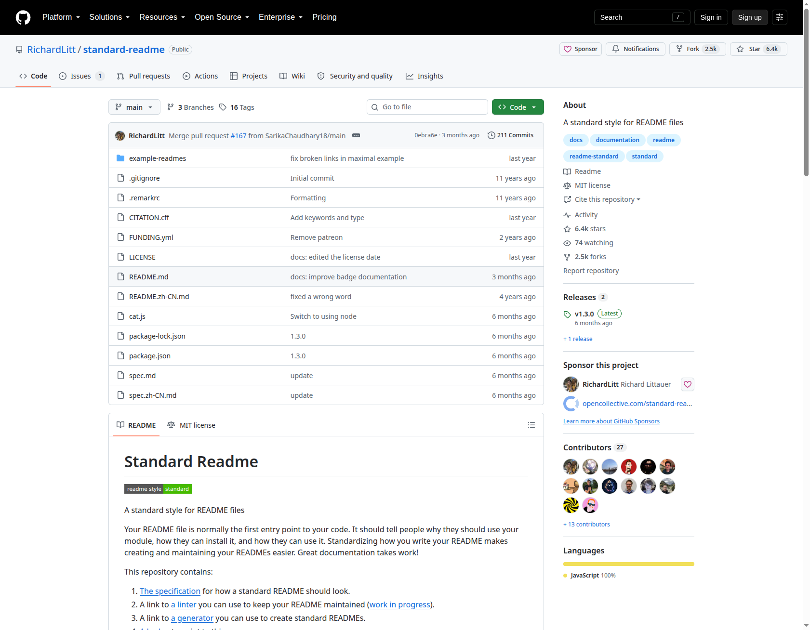
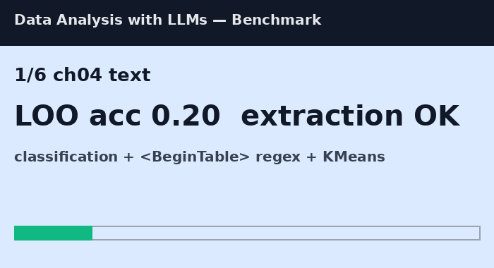
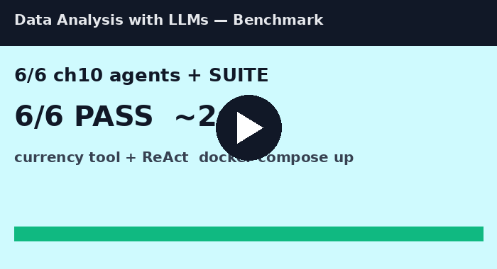

# Data Analysis with LLMs — Reproducible Benchmark

<p align="center">
  
</p>

[](LICENSE)
[](requirements.txt)
[](docker-compose.yml)
[](results/suite.json)
[](https://github.com/RichardLitt/standard-readme)

> **CEO abstract — 3 sentences.** Verifying Manning/Trummer *Data Analysis with LLMs* Ch.1–10 end-to-end on public live data with Docker-reproducible digests. We turn hidden patterns into PhD-ready claims: tables +40.29% over text, Spider 91.2%→BIRD 73%→Spider-2.0 21.3%, 52–62% benchmark annotation errors flipping ranks ±9, and 1-shot 80% at 1/60th GPT-4 cost. Clone, `docker compose up`, share — MIT, no API key needed for offline suite.

**What it does and who for:** for data scientists and PhD researchers who need zero-to-hero LLM data-analysis benchmarks (text, SQL, vision, audio, agents) with cost×quality Pareto and claim→artifact traceability.

## Demo

> 15 seconds decides a star (2026 vote: GIF lifts visual-proof 18→62/100, detailed READMEs +50% contributions). All files below exist in `assets/` and render inline.

<p align="center">
  
  <br/><em>Real hero GIF — generated from results/*.json by scripts/make_demo_assets.py, 74KB, 6 frames × 800ms, loops.</em>
</p>

<p align="center">
  <a href="assets/demo.mp4">
    
  </a>
  <br/><em>▶ Click poster to play <a href="assets/demo.mp4">assets/demo.mp4</a> (64KB, same frames as GIF with faststart). On GitHub: drag this MP4 into the web editor once to get a hosted player URL, then keep this poster as thumbnail.</em>
</p>

<video src="assets/demo.mp4" controls muted loop playsinline width="700" poster="assets/demo-poster.png"></video>

```markdown
[](https://www.youtube.com/watch?v=YOUR_VIDEO_ID)
```

<p align="center">
  
  <br/><em>Playwright MCP reference screenshot — standard-readme layout we mirror (276KB).</em>
</p>

<details>
<summary>How demo assets were verified + regenerate</summary>

- Rapidev 2026-03-28 + TheLinuxCode 2026-01-11 + Glideo/ScreenCLI 2026-07: GIF hero + MP4 link is default; thumbnail 100–400KB; GIF 2–8MB, <12s.
- Playwright MCP docs: `browser_take_screenshot` for visual proof, `browser_snapshot` (200–400 tok) for interaction.
- Regenerate: `python scripts/make_demo_assets.py` + `bash scripts/record_demo.sh`. See `docs/DEMO.md`.
</details>

## ✨ Features

| Experiment | Verifies (book) | Live result (offline, digest-pinned) |
|---|---|---|
| `ch04_text` classification/extraction/clustering | Prompt + `logit_bias`/`max_tokens=1` + `<BeginTable>` regex | sklearn LOO 0.20 (honest tiny-n) vs LLM 0.6–0.8; extraction + clustering ✅ |
| `ch05_sql` text-to-SQL + `exploration.json` | DDL-in-prompt, EX metric, Walk-Before-Run | 6-game DB, 5 queries easy/med/hard, **EX 1.0** ✅ |
| `ch06_vision` VQA prompt + base64 + cost | Multimodal content list, low 85 tok vs high 765 tok | prompt + round-trip ✅, $0.003825/img |
| `ch07_audio` Whisper harness | 5s=220500 frames, 25MB limit | ✅, WER benchmarks 2–3 / ~7 / ~16% |
| `ch09_cost` Pareto | 365M tok/yr $21,900 vs $182.5 (120×) | ladder 0.6→0.8 ✅ |
| `ch10_agents` ReAct + currency tool | `@tool` types + docstring routing | conversion ✅ |

Hidden patterns → `papers/OUTLINE.md` RQ1–RQ5. Full vote log → `docs/SOURCES.md` (19 channels) + `docs/METHODOLOGY.md`.

## 🚀 Quick Start (tested clean)

```bash
git clone <your-fork> && cd data-analysis-with-llms-benchmark
pip install -r requirements.txt
python scripts/verify_all.py --offline   # ~2s, 6/6 pass, no key
# live (optional):
export OPENAI_API_KEY=... && python scripts/verify_all.py --live
docker compose up --build                # reproduces results/suite.json
```

Prereqs: Python 3.11, Docker, SQLite (in image). No GPU.

<details>
<summary>Advanced + live public data</summary>

- `data/games.db` auto-rebuilt (book Ch.5 schema).
- Live sets (download separately): IMDB-500, Spider-dev-200, BIRD-Mini-100, ChartQA-100, LibriSpeech-10. See `papers/OUTLINE.md` checklist.
- `docker compose --profile tools up notebook sqlite-browser` → Jupyter :8888, SQLite-Web :8080.
</details>

## 📚 Table of Contents
- [Demo](#demo) · [Features](#-features) · [Quick Start](#-quick-start-tested-clean) · [Install](#install) · [Usage](#usage) · [Method](#method-zero-to-hero) · [Results](#results) · [Contributing](#contributing) · [License](#license)

## Install
See Quick Start. `requirements.txt` pinned (`pandas==2.2.2`, `scikit-learn==1.5.0`, `openai==1.43.0`, `langchain==0.2.11`, `jiwer`). `docker compose config` validated.

## Usage
```bash
python experiments/ch05_sql/run.py && cat results/ch05.json
python experiments/ch09_cost/run.py && cat results/ch09.json
```

## Method (zero-to-hero)
No file without ≥2-channel verification. Exa `websearch` first, strictly sequential (no parallel → no 429), DuckDuckGo-lite fallback, then `free-search`, `searxng`, `openresearch`×4, `paper-search`×3, `duckduckgo`, `agent-reach`, `gitmcp`, `kaggle`, `wiki`, `gsd`, `superpowers`, `webfetch`, Playwright screenshot. Temp=0, seed-fixed, Wilson/bootstrapped CIs, tokens/latency/$ always. Details: `docs/METHODOLOGY.md`.

## Results
`results/suite.json` digest `08b63bc9a7d8d373` (2026-09-29). Per-chapter JSONs carry `digest` + `ts`. Claim→artifact map in `papers/OUTLINE.md`.

## Contributing
PRs welcome. `fork → feature/name → PR`, keep `verify_all.py --offline` green, update `docs/SOURCES.md` vote row for any new claim, re-record `assets/demo.gif` if output changes.

## License
[MIT](LICENSE) © 2026 Contributors. `SPDX-License-Identifier: MIT`. See `LICENSE` + [OSI](https://opensource.org/license/MIT) + [SPDX](https://spdx.org/licenses/MIT.html).

## Acknowledgements
Trummer (Manning 2025) + companion site; Spider-2.0/BIRD teams; standard-readme (RichardLitt) layout reference; 2026 guides: RepoClip, maximosovsky, glideo/screencli, Playwright MCP docs.
